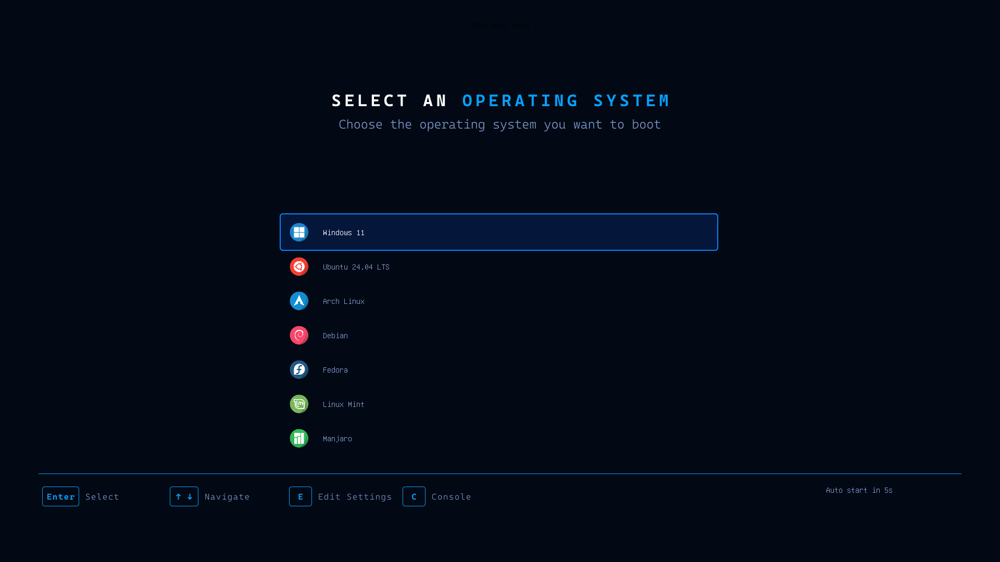

# Futuristic GRUB Theme

A futuristic, dark-themed GRUB 2 boot menu designed for 1920x1080 displays. It features a dark blue background, Cascadia Code typography, operating system icons, a rounded blue selection bar, and a custom terminal frame.



## Features

- **1920x1080 resolution:** Designed for Full HD displays.
- **Dark futuristic design:** Dark background with blue accents and a clean layout.
- **Custom background:** Includes the boot menu title and keyboard navigation hints.
- **Rounded selection bar:** Blue outline with a dark blue fill and extra horizontal padding.
- **Operating system icons:** 28 icons for different operating systems and boot entries.
- **Cascadia Code typography:** Custom GRUB-compatible fonts in sizes 16 and 20.
- **Custom terminal frame:** Black background with a rounded blue border.
- **Automatic boot countdown:** Displays the remaining time before the default entry starts.
- **Nine-slice graphics:** Uses separate image pieces to create scalable menu elements.
- **Python image generators:** Scripts for regenerating the selection bar, menu elements, and terminal frame.

## Repository Structure

```text
.
├── background.png
├── fonts/
│   ├── Cascadia16.pf2
│   ├── Cascadia20.pf2
│   └── OFL.txt
├── icons/
│   ├── arch.png
│   ├── centos.png
│   ├── debian.png
│   ├── deepin.png
│   ├── efi.png
│   ├── elementary.png
│   ├── endeavouros.png
│   ├── fedora.png
│   ├── freebsd.png
│   ├── garuda.png
│   ├── gentoo.png
│   ├── kali.png
│   ├── linuxmint.png
│   ├── mageia.png
│   ├── manjaro.png
│   ├── mx.png
│   ├── opensuse.png
│   ├── parrot.png
│   ├── pop.png
│   ├── redhat.png
│   ├── slackware.png
│   ├── solus.png
│   ├── tails.png
│   ├── ubuntu.png
│   ├── unknown.png
│   ├── void.png
│   ├── windows.png
│   └── zorin.png
├── menu/
│   ├── item_*.png
│   └── selected_*.png
├── terminal/
│   └── terminal_box_*.png
├── screenshots/
│   └── menu.png
├── tools/
│   ├── grub-teste.cfg
│   ├── make_item.py
│   ├── make_selected.py
│   └── make_terminal.py
├── theme.txt
├── LICENSE
├── .gitignore
└── README.md
```

### Directory Overview

| Path | Description |
|---|---|
| `background.png` | Full HD background image containing the title and keyboard hints. |
| `fonts/` | Cascadia Code fonts converted to GRUB's `.pf2` format and the font license. |
| `icons/` | Operating system icons used by GRUB menu entries. |
| `menu/` | Nine-slice images for normal and selected menu entries. |
| `terminal/` | Nine-slice images used to draw the terminal frame. |
| `screenshots/` | Screenshots of the theme. |
| `tools/` | Python scripts for generating graphics and a configuration for previewing the theme. |
| `theme.txt` | Main theme configuration, including layout, typography, colors, and spacing. |

## Requirements

- GRUB 2 with graphical terminal support (`gfxterm`).
- PNG image support.
- A display supporting 1920x1080, or a compatible GRUB graphics mode.
- Python 3 and Pillow for regenerating the graphics.
- Root privileges for installation and system configuration.

The installation instructions below target Ubuntu and other Debian-based distributions using `update-grub`.

The theme was developed for a UEFI system with Ubuntu and Windows in a dual-boot configuration. Other distributions may require different installation commands.

## Installation

**Back up your current GRUB configuration before making changes.**

```bash
sudo cp /etc/default/grub /etc/default/grub.backup
```

### 1. Copy the Theme

Run the following commands from the root directory of the cloned repository:

```bash
sudo mkdir -p /boot/grub/themes/futurista
sudo cp -r . /boot/grub/themes/futurista
sudo rm -rf /boot/grub/themes/futurista/.git
```

The theme files should now be available under:

```text
/boot/grub/themes/futurista/
```

### 2. Configure GRUB

Open the GRUB configuration file:

```bash
sudo nano /etc/default/grub
```

Set the following options:

```bash
GRUB_THEME="/boot/grub/themes/futurista/theme.txt"
GRUB_GFXMODE=1920x1080
GRUB_TIMEOUT_STYLE=menu
GRUB_TIMEOUT=10
```

Make sure these settings are not commented out.

**Important:** Keep `GRUB_TERMINAL=console` commented out. Forcing GRUB to use the console can prevent the graphical theme from being displayed.

The timeout is set to 10 seconds, allowing you to select an operating system before the default entry starts.

### 3. Load the Custom Fonts

GRUB themes reference font names, but the font files must be loaded separately.

Create a script in `/etc/grub.d/`:

```bash
sudo nano /etc/grub.d/04_futurista_fonts
```

Add the following content:

```sh
#!/bin/sh
cat << 'EOF'
loadfont /boot/grub/themes/futurista/fonts/Cascadia16.pf2
loadfont /boot/grub/themes/futurista/fonts/Cascadia20.pf2
EOF
```

Save the file and make it executable:

```bash
sudo chmod +x /etc/grub.d/04_futurista_fonts
```

Verify its permissions:

```bash
ls -l /etc/grub.d/04_futurista_fonts
```

The permissions should include the executable bit.

The script must be executable; otherwise, `update-grub` may ignore it.

**Note:** The current `theme.txt` uses Cascadia Code font sizes 16 and 20. Load additional font files only if you introduce them into the theme configuration.

### 4. Update GRUB

Generate the updated GRUB configuration:

```bash
sudo update-grub
```

Verify that the font-loading commands were included:

```bash
sudo grep -n loadfont /boot/grub/grub.cfg
```

You should see references to `Cascadia16.pf2` and `Cascadia20.pf2`.

Restart the computer to test the installed theme:

```bash
sudo reboot
```

### Windows Does Not Appear?

If Windows is missing from the boot menu, check whether OS probing is enabled.

Open the configuration:

```bash
sudo nano /etc/default/grub
```

Add or uncomment:

```bash
GRUB_DISABLE_OS_PROBER=false
```

Then regenerate the configuration:

```bash
sudo update-grub
```

This setting allows GRUB to search for other operating systems. Whether Windows is detected also depends on the system configuration and available boot entries.

If the theme fails to load, GRUB may fall back to its default appearance.

## Preview Without Rebooting

You can preview the theme inside a virtual machine using [grub2-theme-preview](https://github.com/hartwork/grub2-theme-preview).

This allows you to test changes to the layout, fonts, colors, icons, and background without restarting your computer or installing the theme.

### 1. Install the Dependencies

On Ubuntu, install the required packages:

```bash
sudo apt update
sudo apt install qemu-system-x86 ovmf grub-pc-bin grub-efi-amd64-bin grub-common xorriso mtools pipx
```

Configure `pipx` if necessary:

```bash
pipx ensurepath
```

Install the preview tool:

```bash
pipx install grub2-theme-preview
```

If the command is not immediately available, open a new terminal or follow the instructions printed by `pipx ensurepath`.

### 2. Run the Preview

From the root directory of the repository:

```bash
grub2-theme-preview \
  --grub-cfg tools/grub-teste.cfg \
  --timeout 10 \
  --resolution 1920x1080 \
  .
```

The tool launches GRUB in a virtualized environment.

The `tools/grub-teste.cfg` file contains sample boot entries for previewing the available operating system icons.

The `--timeout 10` option sets the preview countdown to 10 seconds.

If the preview window is too large for your display, try:

```bash
grub2-theme-preview \
  --grub-cfg tools/grub-teste.cfg \
  --timeout 10 \
  --resolution 1920x1080 \
  --display gtk,zoom-to-fit=on \
  .
```

**Tip:** Test your changes with the preview tool before installing them to `/boot/grub/themes/`.

## Customization

The theme can be customized by editing `theme.txt`, replacing images, or modifying the Python scripts in `tools/`.

### Menu Layout

The boot menu is configured in `theme.txt`.

| Property | Current value | Description |
|---|---|---|
| `left` | `28%` | Horizontal position of the menu. |
| `top` | `38%` | Vertical position of the menu. |
| `width` | `44%` | Menu width. |
| `height` | `45%` | Menu height. |
| `item_height` | `60` | Height of each menu entry. |
| `item_spacing` | `6` | Vertical spacing between entries. |
| `icon_width` | `42` | Displayed icon width in pixels. |
| `icon_height` | `42` | Displayed icon height in pixels. |
| `item_icon_space` | `25` | Space between the icon and its label. |
| `item_color` | `#7E9CD2` | Normal menu text color. |
| `selected_item_color` | `#FFFFFF` | Selected menu text color. |

The menu's position and dimensions are expressed as percentages of the screen, while item dimensions and spacing are specified in pixels.

To change the number of visible entries, adjust the menu height and spacing. The final result also depends on GRUB's layout calculations and the available display area.

### Colors

The current color palette includes:

| Element | Color |
|---|---|
| Normal menu text | `#7E9CD2` |
| Selected menu text | `#FFFFFF` |
| Selection border | `#0A84FF` |
| Selection background | `#04163A` |
| Terminal background | `#000000` |

These values are defined across `theme.txt` and the Python scripts that generate the menu and terminal graphics.

Changing a color in `theme.txt` does not automatically change colors embedded in PNG images. Regenerate the corresponding images if you want the graphics to match the new palette.

### Operating System Icons

GRUB uses the menu entry's `--class` value to determine which icon to display.

For example:

```grub
menuentry "Windows 11" --class windows --class os {
    true
}
```

GRUB looks for:

```text
icons/windows.png
```

To inspect the classes generated by your system, run:

```bash
sudo grep -oE -- '--class [a-zA-Z0-9_-]+' /boot/grub/grub.cfg | sort -u
```

If an entry does not display the expected icon, verify that its class matches the corresponding PNG filename.

The current icons are 84x84 pixels and are displayed at 42x42 pixels in the boot menu.

The operating system names shown in the menu come from GRUB's menu entries, not from the theme itself.

### Regenerating the Menu Graphics

The selection bar and terminal frame use a nine-slice image layout. Each graphic is divided into nine pieces so GRUB can stretch the center and edges while preserving the corners.

The graphics are generated using Python and [Pillow](https://pillow.readthedocs.io/).

From the repository root, run:

```bash
python3 tools/make_selected.py
python3 tools/make_item.py
python3 tools/make_terminal.py
```

The scripts generate:

- `menu/selected_*.png`: The selected menu entry graphics.
- `menu/item_*.png`: Transparent graphics for normal menu entries.
- `terminal/terminal_box_*.png`: The terminal frame graphics.

Run `make_item.py` after regenerating the selection bar. The normal and selected menu images must have matching dimensions to prevent the menu entries from shifting when the selection changes.

The selection bar also uses additional horizontal padding to keep the icons and text away from its edges.

### Fonts

GRUB uses pre-generated `.pf2` font files. Each font size must be generated separately.

The current theme uses:

- `Cascadia16.pf2`
- `Cascadia20.pf2`

To generate an additional font size, use `grub-mkfont`.

For example, assuming the Cascadia Code font is installed at the path below:

```bash
grub-mkfont -s 24 -o fonts/Cascadia24.pf2 /usr/share/fonts/truetype/cascadia-code/CascadiaCode.ttf
```

The source font path may vary depending on how Cascadia Code was installed.

Check the internal font name:

```bash
strings fonts/Cascadia24.pf2 | sed -n 3p
```

The font name referenced in `theme.txt` must match the name stored inside the `.pf2` file.

After generating a new font:

1. Reference its internal name in `theme.txt`.
2. Add a corresponding `loadfont` command to the font-loading script.
3. Copy the updated files into the installed theme directory.
4. Run `sudo update-grub`.
5. Test the changes.

### Background Image

The background image must be 1920x1080 pixels for the intended display resolution.

Replace `background.png` to change the appearance of the theme.

The title and keyboard navigation hints are embedded in the image, so they must be edited in the image itself.

Leave enough empty space for the boot menu and countdown, since GRUB renders these elements over the background.

### Terminal Frame

The terminal frame is defined by the `terminal-box` image pieces in `terminal/`.

The current configuration uses:

```text
terminal-border: "24"
```

This value corresponds to the corner size generated by `tools/make_terminal.py`.

If you change the frame dimensions or margins in the generator, make sure the terminal configuration remains consistent with the generated graphics.

## Updating the Installed Theme

After changing files in the repository, copy the updated files into the installed theme directory:

```bash
sudo cp -r . /boot/grub/themes/futurista/
sudo rm -rf /boot/grub/themes/futurista/.git
```

If you changed only the background, icons, or PNG graphics, you generally do not need to regenerate `grub.cfg`.

If you changed GRUB settings or font-loading commands, run:

```bash
sudo update-grub
```

Preview the theme before rebooting whenever possible.

## Uninstallation

To remove the theme and restore the saved GRUB configuration:

```bash
sudo rm /etc/grub.d/04_futurista_fonts
sudo rm -rf /boot/grub/themes/futurista
sudo cp /etc/default/grub.backup /etc/default/grub
sudo update-grub
```

This restores the configuration saved during the installation procedure.

**Warning:** If you made other GRUB changes after creating the backup, restoring it will also discard those changes. Review the backup before replacing your current configuration.

## Known Limitations

- Designed for 1920x1080 displays; other resolutions have not been tested.
- The background title and keyboard hints are static parts of the background image.
- GRUB theme configuration does not provide a general letter-spacing property.
- Font sizes must be generated separately as `.pf2` files.
- Operating system icons depend on the classes assigned to GRUB menu entries.
- Installation commands and configuration paths may differ across Linux distributions.

## Credits and Licenses

- **Theme:** MIT License. See [LICENSE](LICENSE).
- **Font:** [Cascadia Code](https://github.com/microsoft/cascadia-code), developed by Microsoft and distributed under the SIL Open Font License 1.1. The converted font files are included in `fonts/`.
- **Font license:** See `fonts/OFL.txt`.
- **Icons:** Operating system icons adapted from [relliv/OperatingSystemIcons](https://github.com/relliv/OperatingSystemIcons). The icons were resized to 84x84 pixels for use in this theme. All rights to the original artwork remain with their respective creators.
- **Preview tool:** [grub2-theme-preview](https://github.com/hartwork/grub2-theme-preview), developed by Sebastian Pipping.
- **Trademarks:** Operating system names and logos belong to their respective owners. Their use is intended only to identify boot menu entries and does not imply endorsement.

## Contributing

Contributions are welcome.

Ideas for improvements include:

- Additional operating system icons.
- Support for more display resolutions.
- Improvements to menu layout and typography.
- Testing on additional Linux distributions.
- Improvements to the preview and image generation tools.

Feel free to open an issue or submit a pull request.